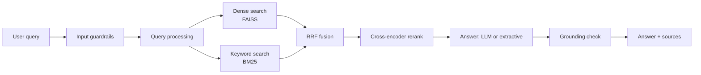

# 🔎 Production RAG Assistant

A modular **Retrieval-Augmented Generation** system that answers questions from your documents with cited sources.
It combines semantic search, keyword search, rank fusion and cross-encoder reranking, with guardrails, an
evaluation harness, metrics logging, a FastAPI backend and a multi-tab Streamlit UI.

> Works **with or without an LLM key**: with an [OpenRouter](https://openrouter.ai) key it generates answers;
> without one it falls back to extracting the most relevant sentences from the retrieved documents.

## ✨ Features

- **Hybrid retrieval** – FAISS dense search (`all-MiniLM-L6-v2`) + BM25, merged with Reciprocal Rank Fusion
- **Cross-encoder reranking** – `ms-marco-MiniLM-L-6-v2` re-scores candidates against the original question
- **Query processing** – splits multi-part questions (`... and ...`) and expands domain terms
- **Guardrails** – input checks (empty, oversized, prompt-injection patterns) and an output grounding check
- **LLM with fallback** – model fallback list via OpenRouter, then graceful extractive answers
- **Self-maintaining index** – rebuilt automatically when documents or chunk settings change
- **Evaluation** – answer accuracy, retrieval hit-rate and latency over `benchmark/questions.json`
- **Observability** – per-stage latency, `reports/metrics.csv`, `/health` endpoint
- **Streamlit UI** – chat with source cards, knowledge-base manager (upload + re-index), evaluation runner, metrics dashboard, architecture view

## 🏗️ Architecture



## 🚀 Quick start

```bash
git clone https://github.com/rakesh-1450/AI-Production-RAG-System.git
cd AI-Production-RAG-System
python -m venv venv && source venv/bin/activate      # Windows: venv\Scripts\activate
pip install -r requirements.txt
cp .env.example .env                                  # optional: add OPENROUTER_API_KEY

streamlit run streamlit_app.py                        # UI  -> http://localhost:8501
uvicorn main:app --reload                             # API -> http://localhost:8000/docs
```

The vector index is created automatically on first run (the embedding models download once).

## ☁️ Deploy on Streamlit Community Cloud

1. Push this repo to GitHub.
2. On [share.streamlit.io](https://share.streamlit.io) choose **New app** → select the repo → main file path: `streamlit_app.py`.
3. Under **Advanced settings → Secrets** paste (see `.streamlit/secrets.toml.example`):
   ```toml
   OPENROUTER_API_KEY = "sk-or-..."   # optional
   ALLOW_UPLOADS = "false"            # recommended for a public demo
   ```
4. Deploy. The first start takes a minute while models download and the index is built.

## ⚙️ Configuration

| Variable | Default | Purpose |
|---|---|---|
| `OPENROUTER_API_KEY` | – | Enables LLM answers (otherwise extractive mode) |
| `LLM_MODELS` | `openai/gpt-4o-mini,anthropic/claude-3-haiku` | Comma-separated models, tried in order |
| `ALLOW_UPLOADS` | `true` | Let UI users add documents (disable on public demos) |

Chunk size, top-k and model names live in `app/config/settings.py`. Check current model IDs on [openrouter.ai/models](https://openrouter.ai/models).

## 🔌 API

```bash
curl -X POST http://localhost:8000/query \
  -H "Content-Type: application/json" \
  -d '{"query": "What are the office timings?", "top_k": 5, "context_k": 3}'
```

Returns `answer`, `mode` (`llm` / `extractive`), `model`, `sources`, `contexts` (with relevance scores), per-stage `stages` latency and an optional `notice`.
`GET /health` reports index and LLM status.

## 🧪 Evaluation & tests

```bash
python -m scripts.run_evaluation     # benchmark over benchmark/questions.json
pip install -r requirements-dev.txt && pytest
```

## 📂 Project structure

```
├── streamlit_app.py        # Streamlit UI (main file for deployment)
├── main.py                 # FastAPI app
├── app/
│   ├── api/                # routes + schemas
│   ├── config/             # settings
│   ├── core/               # embeddings + FAISS vector store
│   ├── ingestion/          # loader, chunking, index builder
│   ├── retrieval/          # BM25, dense, hybrid, RRF, query processor
│   ├── reranking/          # cross-encoder reranker
│   ├── generation/         # prompt, LLM client, extractive fallback, pipeline
│   ├── guardrails/         # input + output guardrails
│   ├── evaluation/         # evaluator + metrics logger
│   └── utils/
├── ui/                     # CSS and diagram for the Streamlit app
├── data/documents/         # sample knowledge base (fictional company)
├── benchmark/questions.json
├── scripts/                # build_index, run_evaluation
└── tests/
```

## 📝 Notes

- The sample documents describe a **fictional company** ("Nimbus Labs") and exist only for demonstration.
- Documents you upload are sent to the embedding/reranking models locally; only the retrieved context and your question are sent to OpenRouter when an LLM key is set.

## 📄 License

MIT – see [LICENSE](LICENSE).
